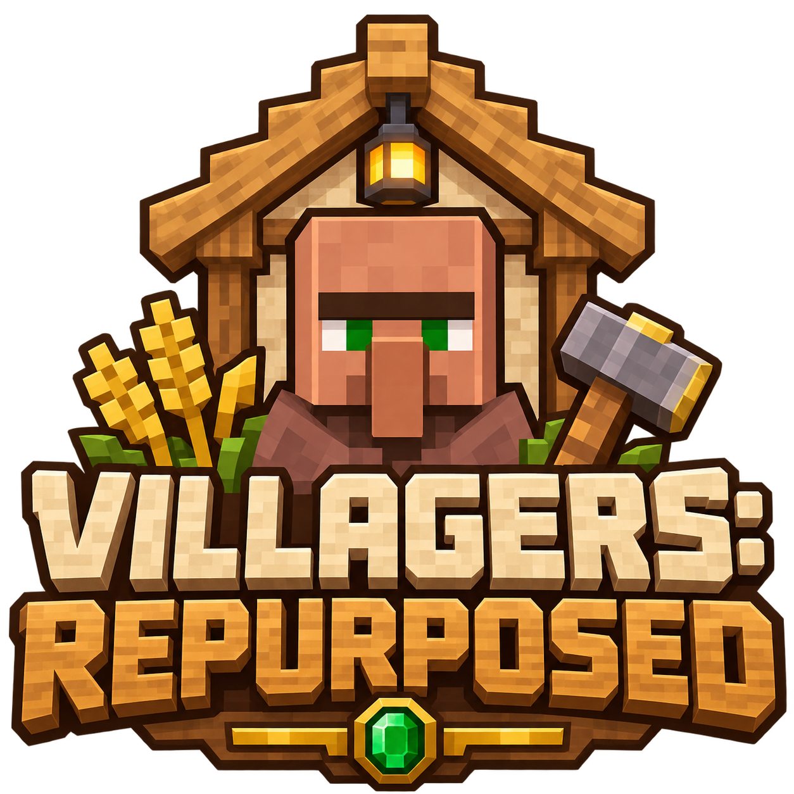

# Villagers: Repurposed (Fabric, Minecraft 26.2)
> **A living village, block by block.** Villagers: Repurposed gives Minecraft villages homes, daily routines, work, trade, and room to grow.

[Project website](https://cvvluis.github.io/Villager-Repurposed/) · [GitHub repository](https://github.com/cvvluis/Villager-Repurposed) · [Luis's portfolio](https://cvvluis.github.io/)

**Fabric · Minecraft 26.2 · Java 25**

Villagers: Repurposed turns a village into a small, persistent community. Residents keep homes and personal belongings, follow a daily schedule, take on jobs, trade with neighbours, and build useful places as the village grows. The project is under active development; compatibility and feature status are documented below and in the project docs.

### Explore

- [What the mod does](#new-in-090-trade-network-village-shrine-and-market-life)
- [Project website](https://cvvluis.github.io/Villager-Repurposed/)
- [More projects by Luis](https://cvvluis.github.io/)

Villagers have names, fixed houses with a sign, a fixed daily schedule and real tasks. The village gets a village center
with a double chest and grows on its own. Server and client mod (the Info button needs the mod on the player's side too; single player works), requires Fabric Loader 0.20.1+,
Fabric API and Java 25.

## New in 0.10.8: the village map no longer loads chunks (playtest 11)

When entering a village in the large modpack, the server thread hung in the relief sampling of the large Dorftafel (village board) (`VillageMap.grid` / `classifyFine`): `hasChunkAt` applied only to the cell center, and `getHeight`/`getBlockState` synchronously generated missing neighboring columns (`getChunkBlocking`). The picture froze and the server reported "Can't keep up".

- The map, relief and text map now read only chunks that `getChunkNow` already has fully loaded. At most 480 cells with four samples each are classified per call; the rest appears over the next ticks. A finished grid stays valid for 10 seconds, one with unknown cells for 5 seconds. A failed sampling is no longer repeated every 20 ticks.
- The same non-blocking height reading applies to the mod's other terrain sampling (paths, building sites, professions) instead of generating chunks there.
- The stall watchdog no longer treats `managedBlock`/`pollTask` as a pause when the stack is in `getChunkBlocking`. The client counts frames (3-second threshold) instead of game ticks.
- The relief uses the entity-translucent RenderType. Iris does not know `minecraft:pipeline/debug_quads`.

Not measured in the modpack, only compiled.

## New in 0.10.7: no false alarm on world start (playtest 10)

The client's stall report now counts only while a world is running. While a world is being created or loaded, the client loop stands still on its own; in 0.10.6 this was a false alarm.

## New in 0.10.6: stall report (playtest 9)

Diagnostics only, not a fix: if the game or server freezes for more than 8 seconds, the mod writes the thread stacks to `logs/villagerplus-stall-server.txt` or `-client.txt` (at most three reports per launch). This shows which code (this mod or another) holds the stall. A paused single-player server does not count as a stall. The cause of the freezing in the modpack has still not been found.

## New in 0.10.5: three hand-built template houses (playtest 8)

Checked only on the dev server (test groups), not in the client and not built in a natural run.

- New building templates with the original materials: village house (`haus_dorf`, 14x13), town hall with porch (`rathaus_dorf`, 22x23) and smithy with residence (`schmiede_dorf`, 19x15). The builders place them block by block from the village supply. Whatever a village cannot produce is substituted; if stair material or roof tiles are missing, the stairs fall back to cobblestone stairs.
- Not built: lava, bells, ladders, pots, carpets, signs, workstations and similar, so that no foreign workstations or filler blocks appear; a hidden foundation under the floor is dropped.
- So far only the village house is used in game: new plans with a tall two-story design (about every sixth new house) take it instead of the small 9x9 house. Running plans keep their shape. Town hall and smithy exist only in the library; the town hall is still built from the previous design.

## New in 0.10.4: the village toast no longer crashes (playtest 7)

The animated village toast (the pop-up at the top right for village messages) now catches every error and then disables itself; the chat message stays. `-Dvillagerplus.toast=false` turns it off entirely. The crash cause itself has not been found (no crash report available); only compiled on the dev server, not checked in the client.

## New in 0.10.3: no more force-loading (playtest 6)

Second hotfix against "Can't keep up" in the large modpack. Not measured in the modpack, only checked on the dev server.

- The mod no longer sets /forceload chunks. The nearest village is held only with short-lived tickets, only for chunks that are already loaded (new terrain is never generated), not while a player is nearby and not when the server is already overloaded (mean tick time above 40 ms).
- Old forced chunks from 0.10.0 to 0.10.2 are released during play. `-Dvillagerplus.keptVillages=0` turns off the holding entirely.

## New in 0.10.2: less server load (playtest 5)

Hotfix for lag in the large modpack ("Can't keep up", high ping). Not measured in the modpack, only checked on the dev server.

- Previously the mod kept every known village permanently loaded (many chunks, stored in the world as /forceload). Now at most one village per dimension stays loaded, the one closest to the nearest player, with a smaller area. All other villages, including old forced chunks from existing worlds, are released and work only while a player is in range.
- Configurable with `-Dvillagerplus.keptVillages=N` (default 1, 0 = never force-load chunks). /forceload chunks set by hand within the area of a released village are released too.

## New in 0.10.1: food chain and more stone work (playtest 4)

Status: checked only on the dev server (test groups, fixtures, natural runs without players), **not tried in the client or full pack**. Still, no building has been completed in a natural run; the field plan in the hunger state still fails on fence wood. Nine test groups are red at this state (see CLOUD-LOG, causes open).

- **Food:** Farmers harvest ripe crops across the whole village, and with shortages also by fishing; food goes through a limited bridge to the village chest ahead of the granary; scarce midday portions go to the hungry; a pen that cannot be started no longer blocks the field plan.
- **Stone and wood:** idle residents and free masons work on cobblestone when plans are waiting; wood supply and planks in the block.
- **First building:** flow and test group for the first building; residents tick without a player (chunk lease radius 2).

## New in 0.10.0: more stable villages (playtest 3)

Status: checked only on the dev server (test groups, synthetic fixtures and natural runs without players), **not tried in the client or full pack**.
No building has been completed yet in a natural run; cobblestone and wood are the bottleneck.

- **Recall:** Residents with no path to the village road (e.g. on fence posts or in hollows) are brought back when real navigation finds no path; deep terrain counts only after 3600 ticks or after a fall.
- **Quarry, mine, wood:** nearest reachable stone cells first, remembered blocked regions, miners deliver cobblestone on demand, mine without oak-plank blockage, movement lock only in the tunnel, trees only with a way back.
- **Building sites:** granary and other civic buildings find a terraced site with tree clearing on slopes; plans start with an obtainable palette; the house search stores its cursor.
- **Professions:** the butcher smokes raw meat from the granary; house signs are no longer placed twice; the farmer respects Serene Seasons (the first field may sow wheat outside the season).
- **Modpack:** runtime check of profession assignment (More Villagers, Village Taverns), of the Serene Seasons tags and of the Towns-and-Towers villages; the server runs without Farmer's Delight, Chef's Delight and Serene Seasons without class-loading errors.

## New in 0.9.0: trade network, village shrine and market life

- **Large plaza with village shrine:** octagonal square in the village palette, roofed shrine, seating, lighting, village chest and Dorftafel (village board). The search protects existing houses and takes open paved areas into account. In dense villages the new center can sit on a free expansion area. Houses are not moved. New buildings keep five free blocks of distance from the outer plaza or from the shop huts, including awnings.
- **Village journal:** new tab with trade, wellbeing and building, resident filter and ranking by trade volume. Relevant state changes and activities persist across restarts. Separate history limits (96 wellbeing, 128 each for trade and building events) keep routine reports from displacing important building or trade messages.
- **Shopkeepers:** up to three private shops, one for each eight residents. The first shop prefers an adult; further ones can be assigned to children as a future career. After growing up they build small huts in the village palette with roof, timber frame, window and striped awning. Material is really taken from the village supplies. Essential workers are not pulled away.
- **Real purchases:** shopkeepers buy goods from the village community with private emeralds; residents buy during shared opening hours in the midday break. Goods, money and private chests are really changed; no emeralds are created by these deals. Shop owners also get regular breaks. On death a successor is possible; foreign blocks on building sites are not overwritten.
- **Neighbors:** three fictional trade partners with specialties and relationship, plus up to twelve real village links. Take a village map from the menu and redeem it at another Dorftafel (same dimension, at most 3000 blocks, both villages loaded). Goods exchange, trade route, guests and greetings with mutual cooldowns; the exchange checks space and equal goods value before changing anything.
- **Caravans:** named trader with two leashed, loaded donkeys, start preferably 70–100 blocks from the bell, arrival at the chest and normal player offers. Traded goods are visibly unloaded stack by stack from the donkey chests into the village chest/storage; full storage makes the cargo donkey wait. Trade/gifts affect relationships, active routes the frequency. If no loaded arrival spots exist, there is a nearby fallback or a later attempt.
- **Custom name displays:** compact two-line, colored displays with name, profession and stars; only nearby and with normal line-of-sight occlusion.
- **Orderly paths:** three-block-wide straight connections between village center/bell and active trade routes. Only loaded, suitable ground cells are converted; houses, fields and water stay protected. There is no automatic tunnel or bridge building.
- **Population growth:** new houses need a growing population and housing demand. An initial observation period prevents the first loading of the villagers from counting as growth immediately. Large villages are considered up to 128 residents.

### Test notes

The CTOV test world uses CTOV 4.1.0, Lithostitched 1.8.0 and Cloth Config. The fresh large CTOV desert village is at 7328 / −416, its mod village bell at 7333 / 78 / −423 and the new plaza at 7397 / 66 / −450. The old area around −338 / −303 contains historical test remnants.

Development commands (Loom development environment only): `/vpkaravane`, `/vptest090 run`, `/vptest090 verify`, `/vptest090 board`. The test series creates delimited test buildings at 12000 / 201 / 12000; these are not naturally grown villages. It checks logic and inventory preservation. The additional real run in the fresh CTOV village checks autonomous flows. Details and actually observed results: `TEST-REPORT-0.9.0.md`.

## Daily schedule (all adult villagers, time since sunrise)
| Time (ticks) | Phase |
|---|---|
| 0–1000 | **Morning:** breakfast at home (from their own chest), goods to the village chest, chat at the village square |
| 1000–2800 | **Work** (main task) |
| 2800–3300 | **Break:** chat with neighbors (find a conversation partner, stand together, talk, exchange gossip) |
| 3300–5000 | **Work** (main task) |
| 5000–6500 | **Midday** at the village square: deliver, eat together, restock, chat |
| 6500–8300 | **Work** (side task) |
| 8300–8800 | **Break:** chat |
| 8800–10500 | **Work** (side task) |
| 10500–12000 | **Evening** at home: dinner, personal belongings into their own chest |
| from 12000 | Night: sleep in their own house (vanilla) |
On alarm (raid, panic, combat) the schedule pauses. Anyone who has not eaten for a long time works at only half speed.
## Professions
| Profession | Main task | Side task |
|---|---|---|
| Farmer | harvests & replants | bakes bread (3 wheat), **lays out new fields** (seeds in the village chest) |
| Shepherd | shears sheep | builds beds (3 wool + 3 planks) |
| Butcher | slaughters surplus (>8/species), collects drops | cooks meat/fish/potatoes |
| Fisherman | fishes at the water | fishes |
| Armorer/Weaponsmith/Toolsmith | repairs iron golems (ingot: +25 HP, without: slow +5) | smelts raw iron/nuggets into ingots |
| Cleric | heals villagers, golems, players | heals |
| Mason | **builds houses & wells**, places torches | same |
| Fletcher | arrows (flint+stick+feather), sticks | same |
| Leatherworker | books (leather + 3 paper) | same |
| Cartographer | paper (3 sugar cane) | same |
| Librarian | bookshelves (6 planks + 3 books) | same |
| Unemployed / Dorftrottel (village fool) | **Carriers**: pick up items lying around for >5 min and bring them to the chest | same |

## Private property
Each villager gets their **own chest** in their house (near the bed, indoors, not in front of the door). It belongs to them:
in the evening they store personal belongings there (everything except work goods and some provisions), and in the morning/evening they eat from it.
For every 80 completed tasks they receive one **emerald as wages** – from the village treasury (village chest), not out of thin air; if there is none, it is skipped. Players *can* open the chest, but then lose
standing with the owner (opening: small, destroying: large), and the neighbors learn about it through gossip.

## Names, houses, signs
- Every villager gets a German name (unless named with a name tag).
- The bed they pick the vanilla way becomes their permanent home (stored in memory).
- Next to the front door hangs a **sign** (wood type of the door): name, profession and level. If several share a house, it reads "Haus von …" (House of …).
- If houses are missing (a villager without a bed or fewer than 2 free beds), the mason builds a new one.

## Village center (compatible with world-generator mods)
Nothing is hooked into world generation. Instead, villagers recognize their village through the **bell** (meeting point) –
this works for vanilla villages and for villages of any mod that uses normal bells/beds. If there is no village center yet,
the villagers create one within 3–9 blocks of the bell: a 5×5 square in the village's ground material, a **double chest (the village chest)** and
four lantern posts. If a double chest already lies within 12 blocks, it is adopted.

## Houses like their surroundings – only with population growth
**When:** A new house is built only when the population grows: when someone has no bed, or all beds are occupied *and*
there are more residents than at the last house build. Before that nothing happens (wells/fields see below).
**How:** The mason picks a random existing house of the village (around a bed) and **copies it block by block**: same shape, roof,
windows, materials – also in mod villages. The house is rotated so that the door faces the village center. Blocks with block entities (chests,
signs, workstations) are not copied; the villagers place their own chest and the sign themselves after moving in.
If no delimited house is found, the mason builds a standard house in the detected village style (floor, walls, roof, stairs, door).
**Material:** The village chest must contain the required blocks (exactly those of the model house; beds and wooden doors any). If something is missing,
players nearby get a message with the largest gaps. `Config.MATERIAL_COST_PERCENT` lowers the share that really has to be paid (0 = free).
Afterwards the mason lays a path to the bell. Other structures: well (8 wall blocks), fields (7×7 with water, seeds ≥16 in the chest, up to 3).
The build order is stored at the bell and survives restarts.
## Trade menu: Info button and wellbeing
In the trade menu there is an **"Info"** button above the window. It shows the villager's **profile** to the left of the menu (live, updated every 1 s):
name, profession and level, current activity, **mood, satiety, energy, social, health** (with bars), house (with own chest), possessions (emeralds),
reputation with you, gifts, completed work, conversations and whether prices currently have a discount/surcharge.
For this, the mod must be installed **on the client too** (the server supplies the data; without the client mod only the button is missing).

Wellbeing is not decoration but real logic:
- **Satiety** falls since the last meal (30,000 ticks to 0). Below 25% the villager eats a bite from their inventory in between.
- **Energy** falls since last waking up (20,000 ticks to 0), sleep refills it.
- **Social** falls since the last conversation (15,000 ticks to 0), chatting in the breaks refills it.
- **Mood** = 30% satiety, 25% energy, 20% social, 15% house, 10% health, plus up to +10 for possessions (emeralds).
- Effect: mood < 50% → they work only 3/4, < 35% → 1/2, < 20% → 1/4 of the time.
- **Prices:** from 80% mood a small discount (5%), below 25% a surcharge (10%).
- **Trade:** below 10% mood the villager refuses to trade ("too exhausted and hungry").
- Sneak + right-click with an empty hand still shows a short version in the chat overlay.
## Raw materials: mine, logging, workshop
Building material does not come out of thin air. If the village chest lacks something for a build, the village adds it to a **wish list**, and the villagers procure it:
- **Mine:** The village lays out a mine away from the settlement (entrance with lantern and sign "Dorfmine" (village mine), stairs down, then a tunnel). Masons (stone) and smiths (iron/coal) **really mine** the blocks: stone, dirt, gravel, ores including adjacent ore veins. Water, lava, spawners or falling blocks end the tunnel, after which a new mine is laid out.
- **Logging:** The fletcher fells real trees (top to bottom) and replants a sapling if they have one.
- **Workshop:** From raw materials, masons/fletchers craft by item name: planks from logs, stairs/slabs/walls/fences/gates/doors from the base block, glass panes from glass, stone bricks from stone, stone from cobblestone or glass from sand (with coal). This also works for mod blocks that follow vanilla naming.

## Town development
| Residents | Structure |
|---|---|
| from 3 | Well |
| from 6 (and ≥ 1 field) | **Animal pen** (9×9 fence with gate) |
| from 12, all have a house | **Town hall** (9×7, tall gabled roof, in the village style) |
| from 20, town hall stands, village **not too small and not too scattered** (house radius 14–32) | **Town wall** around the village: 5 blocks high with battlements and lanterns, **corner towers (9 blocks)**, four **gates with archway** between gate towers in the middle of each side |
| ongoing, by village wealth | **Wealth structures**: lantern posts → market stall → monument → fountain → festival ground |
Houses are built only with population growth (see above). Everything is built block by block, with material from the village chest.

## Fields grow with the village
The farmer lays out up to 6 fields (about 1 per 4 residents). The 1st–2nd field is 7×7, the 3rd–4th 9×9, from the 5th 11×11 (larger fields get four water sources).

## Village wealth
A score from residents, houses, fields, wells, town hall, wall, pen and the treasures in the village chest (emeralds, diamonds, gold, iron). At 60 / 110 / 170 / 250 / 350 points the masons each put up a representative structure near the village center (see table). The value appears in the info panel and in /villagerplus status.

## Guests from foreign villages
About every 1–1.5 days (from 4 residents) a **single guest** or – in 30% of cases – a **travel group (2–4 people)** in the dress of other biomes arrives. They go to the village chest, bring guest gifts (emeralds + goods matching the profession), stay half a day (you can trade with them) and move on. If there is a free bed, a guest settles permanently with a 35% chance. Guests do not work and do not count toward the population.

## Trade caravan (wandering trader)
Every ~1.5 days (from 5 residents) a wandering trader comes to the village chest and trades resources with an **"imaginary" village**:
they buy surplus (dirt, gravel, cobblestone above 288, ores, food, wool ...) for emeralds and sell what is missing from the wish list, seeds, saplings for logging, torches – and deliver the first animals for the pen. Then they move on.

## Animal husbandry
In the pen, villagers feed cows/sheep (wheat), pigs (carrots) and chickens (seeds) from the village chest, and the animals breed. The butcher keeps the stock small (>8 per species), the shepherd shears the sheep.

## Animations
All activities are visible: the villager holds the matching tool/item in hand (hoe, shears, pickaxe, axe, fishing rod, sword, golden apple, food when eating, building material when building ...), swings the arm, and there are block-break, fishing, heart, eating and conversation particles with sounds. There are no custom body poses (sitting, hammering) – that would require custom client models.

## Commands
- `/villagerplus status` lists nearby villagers (activity, mood, house) and the village (chest, buildings, order, mine, wish list).
- `/villagerplus tafel [uebersicht|details|expeditionen]` also shows the Dorftafel (see below) via command.

## New in 0.7.0
**Dorftafel** (sign next to the village chest, right-click): tabs **Overview** (colored top-down map of the village with buildings, fields, water, paths, forest, bell/chest/board/school/storage/pen/mine and the villagers, plus bar charts for residents, mood, wealth and the supplies food/wood/stone/metal), **Details** (all numbers) and **Expeditions**. The tabs are clickable; sneak + right-click opens the expeditions directly.
**Expeditions:** About every 1.5 days (from 6 residents) 1–3 villagers (profession required, at least 14 ♥) set out for ruins, caves or abandoned strongholds and are away for half a day. After that health and skill level count: they return injured – or not at all (level 3 = stronghold, ambushes). Returnees bring **loot** (village chest, otherwise storage). Healing in sleep. Status and reports are in the "Expeditionen" tab.
**Skills** (slow): levels at 150 / 500 / 1200 / 2600 / 5000 completed tasks, each level +12% speed and extra yields.
**School:** From 5 residents each village builds a small school early (from its own material). Children grow up **3× slower** and go to school during the day; their lessons count as experience for later.
**Storage:** If the village chest is full, the village builds a **storage shed** (7 chests) and brings surplus there; if all are full, it is **expanded** with extensions. If the village chest lacks something from the wish list, the masons fetch it from storage. There are no quantity limits and nothing is thrown away.
**Balanced supplies:** Loggers and miners procure what is scarce compared with food/wood/stone/metal (instead of fixed target amounts).
**Emeralds stay scarce:** Wages come from the village treasury, guests rarely bring one, the trader pays at most 6 per visit.
**Tunnels with supports instead of plain tunnels:** Mine with varying width/height, side tunnels, wooden supports with ceiling beams and torches; the floor is checked before every step (no falling into caves).
**Trader as a source:** Material that the village cannot produce (e.g. colored terracotta) is bought from the caravan. If that fails, the house plan falls back to obtainable substitute material.
**More variety:** New houses copy one of the 6 nearest houses (at random) and are randomly mirrored.
**Permanently loaded:** Villages (7×7 chunks around the bell) and their active mine are kept loaded by force-load (`Config.KEEP_VILLAGES_LOADED`) so that everything keeps running without players.

**Performance:** time budget per tick (Config.TICK_BUDGET_NANOS), automatically less frequent ticking under server load, caches for village search/supplies/storage, column-wise tree search. /villagerplus perf shows the measurements (most recently mean 21–36 µs per tick with 33–155 villagers).
**Profession replacement:** If the last mason/fletcher/farmer drops out, an unemployed or surplus villager takes over (from 8 residents).
The [project page](https://cvvluis.github.io/Villager-Repurposed/) shows the current status and feature overview.

## Compatibility with other mods
- Subclasses of `Villager` and custom names from other mods are managed too.
- Foreign professions: assign them to an activity with the datapack tag `villagerplus:job/<farmer|shepherd|butcher|smith|cleric|mason|fisherman|fletcher|leatherworker|cartographer|librarian>` (registry `villager_profession`); without a tag the mod recognizes keywords in the profession name ("farm", "smith" ...), otherwise the villager works as a carrier.
- Entity tag `villagerplus:ignored`: villager types that should not be managed.
- Wood/wool from other mods counts as obtainable through the vanilla block tags. The mixins use `@WrapOperation` and are optional (`require = 0`).
- Tested with Overhauled Villages (CTOV) 4.1.0 (+ Lithostitched, Cloth Config).

## Compatibility with villages from world-generator mods (e.g. Overhauled Villages)
Houses are delimited via the **structure piece** (jigsaw piece) of the nearest house and copied 1:1 (shape, roof, materials), no matter how large or nested. Hilly terrain is leveled. Loot chests of the villages are never adopted as the village chest.
## Memory
- Vanilla reputation/gossip decays 4× slower (`Config.GOSSIP_DECAY_DIVISOR`).
- Every villager permanently remembers name, house, door, sign, chests, workplaces, completed work and gifts per player.
- **Sneak + right-click with emerald/diamond/bread/golden carrot/cake** = gift (permanently improves reputation → better prices).
- **Sneak + right-click with an empty hand** = name, profession, current activity, house, gifts, work.

## Building
`gradlew.bat build` with JDK 25 → `build/libs/villagers-repurposed-0.7.2.jar` into the `mods` folder. Values are in `Config.java`.
